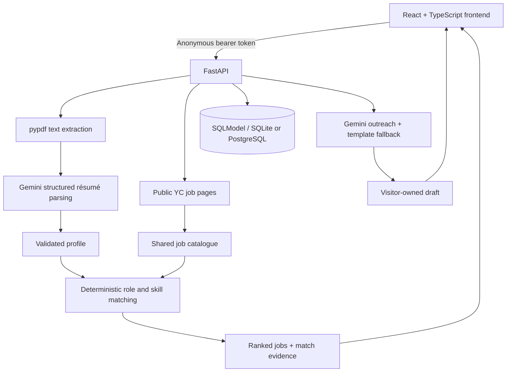

# HireMeNow

**Turn a résumé into a focused startup job search—with visible match evidence and outreach drafts you control.**

[Live app](https://hiremenow-aagam.netlify.app) · [Deployment guide](DEPLOYMENT.md) · [Backend source](backend/src/backend) · [Frontend source](frontend/src)

HireMeNow connects the steps that usually happen across several tabs: reading a résumé, finding relevant startup openings, checking fit, looking for a contact, and writing an introduction. Upload a PDF, review the extracted profile, and explore public Y Combinator job listings ranked against your experience.

**It drafts messages; it never sends them automatically.** Match scores are explainable heuristics, not hiring predictions or employer assessments. Review extracted information, job availability, contacts, and generated text before acting.

## What you can do

- **Build a profile from a PDF.** Extract contact details, skills, experience, education, and suggested target roles with Gemini.
- **Start without a long onboarding form.** Use résumé-derived suggestions immediately or refine roles, location, and work mode.
- **Discover startup openings.** Browse India and US views, including applicable remote listings, using public YC job pages.
- **Understand the ranking.** See matching skills, missing skills, and role evidence beside a fit score.
- **Keep a shortlist.** Star jobs and track reached-out, applied, replied, or rejected status.
- **Find contact context.** Retrieve available founder profiles and public email addresses on a best-effort basis.
- **Prepare outreach.** Generate an email body up to 1,000 characters or a LinkedIn message up to 300 characters, then review and copy/open the destination yourself.
- **Return in the same browser.** An anonymous browser session keeps your profile and job state separate from other visitors.

## A typical walkthrough

1. Open the app and upload a text-based résumé PDF, up to 10 MB.
2. Review the extracted profile and suggested roles. Set a match focus or skip directly to discovery.
3. Choose a region and inspect ranked jobs. Read the matching and missing skills instead of relying only on the score.
4. Refine the search or star a promising opening. Open the original listing to check current requirements.
5. Generate an email or LinkedIn draft, check its facts and recipient, and decide whether to use it.
6. Update the application status to keep track of your next step.

Uploading a replacement résumé resets that browser's previous profile, preferences, drafts, and saved job state **only after the new PDF parses successfully**. A failed upload keeps the previous profile.

## Architecture



### Where AI is used—and where it is not

| Step | Implementation | Why |
| --- | --- | --- |
| PDF text extraction | `pypdf` | Read text from the uploaded document before asking a model to interpret it. |
| Résumé parsing and role suggestions | Gemini through its OpenAI-compatible API, with Pydantic models | Convert varied résumé wording into a consistent profile. |
| Job collection | HTTP requests and HTML parsing | Collect public source data without asking a model to invent openings. |
| Job ranking | Deterministic Python scoring | Make the ranking inspectable and reproducible for the same inputs. |
| Outreach drafting | Gemini, with résumé-based template fallbacks | Help compose a short introduction while retaining a usable fallback. |
| Sending/applying | Visitor action | Keep the final decision with the person using the app. |

This is an AI-assisted application workflow, not an autonomous job-application agent.

## How matching works

The matcher builds a profile from extracted skills, previous job titles, and saved target roles. If no target roles were saved, it uses the résumé's suggested roles.

The displayed score is on a **0–10 scale**:

| Signal | Contribution |
| --- | --- |
| Target role in job title | Up to 3.5 points; partial title overlap or description evidence receives less. |
| Skill coverage | Up to 5 points, based on matched versus detected missing skills. |
| Previous experience title in job title | 1 point. |
| Both a target-role title match and matching skills | 0.5 points. |

The service calculates a doubled internal score and converts it back to the displayed scale. Cards label scores of 7 or above as strong fit, 4 or above as medium fit, and lower scores as low fit. A separate relevance gate filters jobs using role, experience, and skill evidence before ranking.

Whole-term matching prevents examples such as `Go` matching `Google`. A small alias map handles variants such as `Node.js`/`nodejs` and `PostgreSQL`/`postgres`. The known-skill vocabulary helps identify missing skills; the résumé's own skills can also match.

**Limits:** wording, incomplete descriptions, and the skill vocabulary affect results. The score does not establish seniority suitability, visa eligibility, compensation fit, or likelihood of getting an interview. See [matcher.py](backend/src/backend/services/matcher.py) for the exact rules.

## Privacy and session behavior

- The browser stores a random bearer token in `localStorage`; the database stores its SHA-256 hash.
- Résumés, preferences, drafts, starred jobs, and application statuses are scoped to that visitor identity. Public job records are shared.
- The server stores the uploaded PDF, extracted text, and parsed profile in the database. PDF retrieval requires the visitor token; there is no public upload URL.
- Résumé text is sent to the configured Gemini service for parsing. Profile and job context are also used when drafting outreach.
- Sessions expire after seven days of inactivity. Cleanup occurs when sessions are created or an expired session is accessed; deletion is not a precisely scheduled seven-day background task.
- Clearing browser storage or changing browsers loses access to that anonymous session. There is no account recovery or cross-device synchronization.
- The token grants access to the session. Hashing it on the server does not make résumé contents encrypted or eliminate the need to protect the browser and database.
- Private API responses use `Cache-Control: no-store`. Production CORS is restricted to the configured frontend origin.

The API also applies per-process limits to session creation, uploads, scraping, contact enrichment, and draft generation. These are lightweight guards for a single-worker deployment, not a distributed abuse-prevention system.

## Technology

| Layer | Tools |
| --- | --- |
| Interface | React 18, TypeScript, React Router, Vite 6, Tailwind CSS 4 |
| API | Python 3.10+, FastAPI, Pydantic, Uvicorn |
| Persistence | SQLModel; SQLite locally, PostgreSQL for persistent hosting |
| AI | Gemini via the OpenAI-compatible endpoint; model configurable through environment variables |
| Collection | HTTPX, Beautiful Soup |
| PDF processing | pypdf |
| Verification | pytest, TypeScript build, ESLint |
| Deployment configuration | Netlify frontend, Render API; PostgreSQL supplied separately |

## Run locally

Use two terminals. The commands below use Windows PowerShell; on macOS/Linux, replace `.venv\Scripts\python.exe` with `.venv/bin/python` and use your installed Python 3.10+ executable.

### 1. Clone and configure the backend

```powershell
git clone https://github.com/Aagamsheth0601/hiremenow.git
Set-Location hiremenow/backend
py -3.10 -m venv .venv
.\.venv\Scripts\python.exe -m pip install -e .
Copy-Item .env.example .env
```

Set `GEMINI_API_KEY` in `backend/.env`. Keep the other example values for a local SQLite database and frontend at `http://127.0.0.1:5173`. Run from `backend/` so the relative `.env` and SQLite paths resolve correctly.

```powershell
.\.venv\Scripts\python.exe -m uvicorn backend.main:app --reload --host 127.0.0.1 --port 8000
```

Check [health](http://127.0.0.1:8000/health) for `{"status":"ok"}`. Interactive API documentation is available at [ /docs](http://127.0.0.1:8000/docs).

### 2. Start the frontend

In the second terminal, from the repository root:

```powershell
Set-Location frontend
npm ci
Copy-Item .env.example .env
npm run dev -- --host 127.0.0.1
```

Open the URL printed by Vite, normally `http://127.0.0.1:5173`. The frontend defaults to the local API on port 8000. Use the committed lockfile with `npm ci` to reproduce dependency resolution.

### Environment variables

| Variable | Where | Purpose |
| --- | --- | --- |
| `GEMINI_API_KEY` | Backend only | Credential for résumé parsing and generated outreach. |
| `GEMINI_MODEL` | Backend | Model identifier; the checked-in example uses `gemini-3.1-flash-lite`. |
| `GEMINI_BASE_URL` | Backend | Defaults to Google's OpenAI-compatible endpoint. |
| `DATABASE_URL` | Backend | Local SQLite URL or production PostgreSQL connection string. |
| `FRONTEND_URL` | Backend | Allowed frontend origin for CORS. |
| `VITE_BACKEND_URL` | Frontend | Public API origin; defaults to `http://127.0.0.1:8000`. |

Never put an API key or database credential in a `VITE_*` variable: those values are included in the browser build. `.env` files are gitignored; `.env.example` files document configuration without credentials.

## API overview

Except for health and session creation, the routes below require `Authorization: Bearer <visitor-token>`. Obtain the token with `POST /sessions`.

| Route | Purpose |
| --- | --- |
| `GET /health` | Basic API health response. |
| `POST /sessions` | Create an anonymous browser session. |
| `POST /resumes` | Upload and parse a PDF using multipart field `file`. |
| `GET /resumes` | List the current visitor's résumé records. |
| `GET /resumes/latest/pdf` | Retrieve that visitor's stored PDF. |
| `POST /resumes/latest/reparse` | Parse the stored extracted text again. |
| `GET`, `PUT`, `DELETE /preferences` | Read, replace, or clear match preferences. |
| `POST /jobs/scrape` | Refresh public job data. |
| `GET /jobs` | Retrieve jobs with filters and personalized match evidence. |
| `POST /jobs/{id}/enrich` | Resolve available company/contact information. |
| `POST`, `GET /jobs/{id}/draft` | Generate or retrieve a visitor-owned outreach draft. |
| `PATCH /jobs/{id}/star` | Update shortlist state. |
| `PATCH /jobs/{id}/status` | Update application status. |
| `GET /jobs/status-counts` | Retrieve counts for the visitor's job-status filters. |

Use the running API's `/docs` page for complete request schemas, query parameters, and additional endpoints.

## Tests and checks

From `backend/`, install the test tools in your virtual environment and run:

```powershell
.\.venv\Scripts\python.exe -m pip install pytest pytest-asyncio
.\.venv\Scripts\python.exe -m pytest tests -q
```

The checked-in tests cover:

- Relevant-job ranking and matching evidence.
- Separation of private data between visitors.
- Profile replacement and preference flows.
- Outreach length limits and résumé-grounded fallback behavior.
- Contact URL safety, CORS, and public YC job-page parsing.

From `frontend/`:

```powershell
npm run build
npm run lint
```

The build runs TypeScript checking before Vite bundles the app. These checks do not prove live source availability, model accuracy, or job/contact freshness. For an end-to-end smoke test, verify PDF upload, discovery, refinement, draft creation, and isolation between two different browsers.

## Deployment

The repository contains configuration for:

- **Netlify:** `netlify.toml` builds and publishes `frontend/dist`, with an SPA fallback for client-side routes.
- **Render:** `render.yaml` starts the FastAPI service with one worker and a `/health` check.
- **PostgreSQL:** configure a persistent database separately through `DATABASE_URL`. Avoid SQLite on an ephemeral hosting filesystem.

Set `VITE_BACKEND_URL` before building the frontend, and set the API's `FRONTEND_URL` to the exact deployed frontend origin. Keep database and Gemini credentials on the backend only. Follow [DEPLOYMENT.md](DEPLOYMENT.md) for the deployment sequence and smoke checks.

## Repository map

```text
backend/
  src/backend/
    main.py              FastAPI setup, lifespan, CORS, cache policy
    visitor.py           Anonymous identities and expiry cleanup
    rate_limit.py        Per-process expensive-action limits
    models/              Résumés, jobs, preferences, drafts, visitor state
    routers/             HTTP endpoints and ownership checks
    services/
      resume_parser.py   PDF text extraction and Gemini parsing
      matcher.py         Explainable scoring and relevance rules
      yc_scraper.py      Public jobs and company/contact enrichment
      outreach.py        Draft generation and template fallbacks
  tests/                 Focused backend regression tests
frontend/
  src/pages/             Setup and job-discovery screens
  src/components/        Navigation and match-focus controls
  src/lib/api.ts         Typed API models and browser-session handling
netlify.toml             Frontend deployment configuration
render.yaml              Backend deployment configuration
DEPLOYMENT.md            Hosting runbook
AGENTS.md                Project notes and bug history
```

## Tradeoffs and next steps

- **Public-source dependency:** YC markup and listing availability can change. Results and contacts need verification at the source.
- **Text-based PDFs:** image-only scans have no OCR path and cannot be parsed by the current implementation.
- **Heuristic relevance:** matching is transparent but is not a learned semantic ranking model. Geography and remote-work rules are also text-based.
- **AI fallibility:** extracted fields and draft wording can be wrong. Template fallback keeps outreach usable when generation fails, but is not a successful model response.
- **Small-deployment assumptions:** rate limits are process-local and scraping is request-driven. Scaling would need shared limits and background job coordination.
- **Anonymous ownership:** browser-token isolation avoids account onboarding, but does not provide cross-device recovery.

Useful next improvements would be a labeled matching evaluation set, clearer draft-generation provenance, background collection with freshness indicators, and an explicit profile deletion/export flow. These are future work, not claims about the current app.
